# ReconForge

ReconForge is a self-hosted reconnaissance and attack-surface platform for **authorized** web and
IP-based security testing. Give it domains, IP addresses or CIDR ranges and it finds subdomains, hosts,
open ports, web applications, technologies, certificates, endpoints, JavaScript, cloud references and
security findings. It merges what dozens of tools report into one record per asset, keeps history
between scans, flags what changed, and ranks findings so you know what to look at first. It shows all
of it in one dashboard.

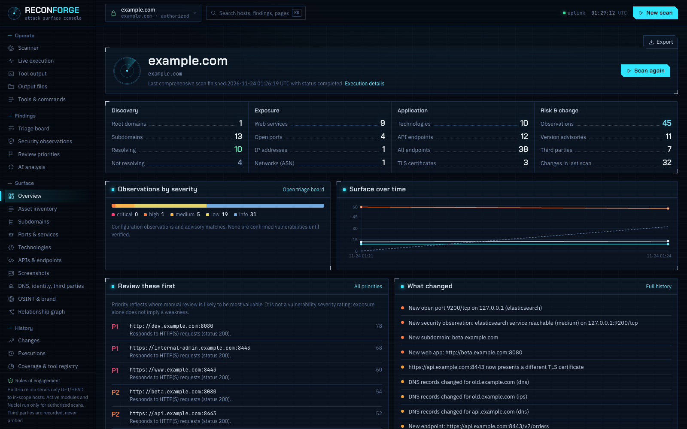

> **Use ReconForge only on systems you own or have written permission to test.** Active modules run
> only when a scan is marked as authorized: tick **I am authorized to test these targets**, or set
> `authorization.confirmed: true` in a config file. Active traffic only goes to IP addresses inside the
> scope. ReconForge's own modules send only GET and HEAD requests. The exception is the optional
> Nuclei module, which runs community templates. Templates tagged intrusive, DoS, fuzzing, brute-force
> or injection are excluded by default.

## Contents

- [Screenshots](#screenshots)
- [What it does](#what-it-does)
- [Installation](#installation)
- [Quick start: dashboard](#quick-start-dashboard)
- [Quick start: command line](#quick-start-command-line)
- [Profiles and modules](#profiles-and-modules)
- [API keys and notifications](#api-keys-and-notifications)
- [Output files](#output-files)
- [Publishing this repository safely](#publishing-this-repository-safely)
- [Lab and demo data](#lab-and-demo-data)
- [Tests](#tests)
- [What has and has not been verified](#what-has-and-has-not-been-verified)
- [Documentation](#documentation)

## Screenshots

Every screenshot shows the built-in demo: the local lab serving a fictional organization as
`example.com`, scanned twice on 127.0.0.1 (see [Lab and demo data](#lab-and-demo-data)). None of it is
real scan data.

| | |
|---|---|
| **New scan.** Paste domains, IPs, CIDRs or URLs, pick a profile, confirm authorization.<br>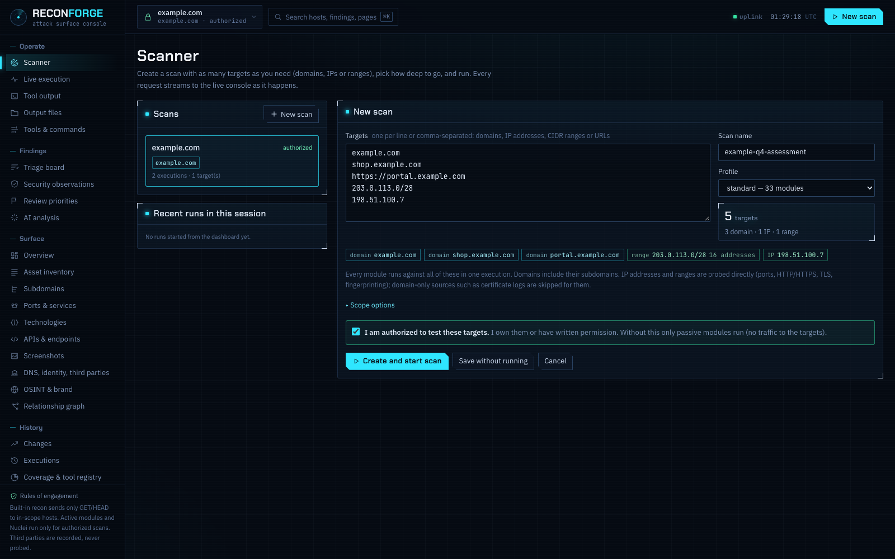 | **Triage.** Every finding ranked by severity, confidence, host exposure and novelty, with decision states and notes.<br>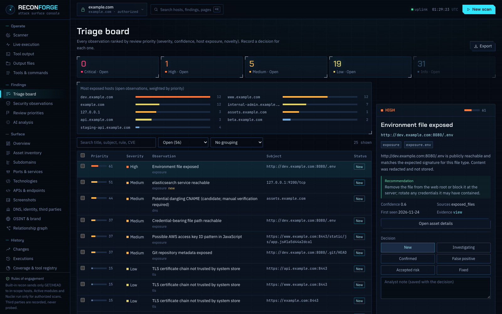 |
| **Security findings.** Grouped by category, with evidence, recommendations, PDF/HTML reports and Burp scope export.<br>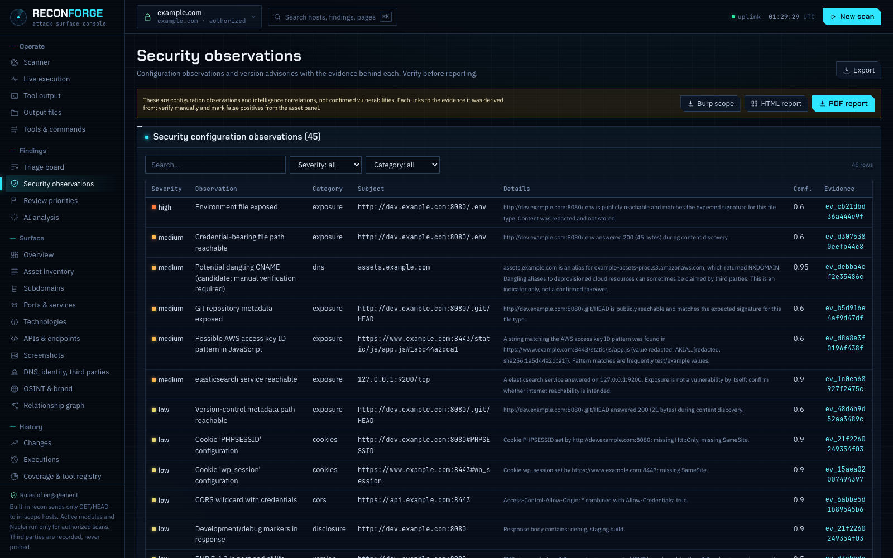 | **Subdomains.** Resolution, IPs, CNAMEs, HTTP status, technologies and sources for every host.<br>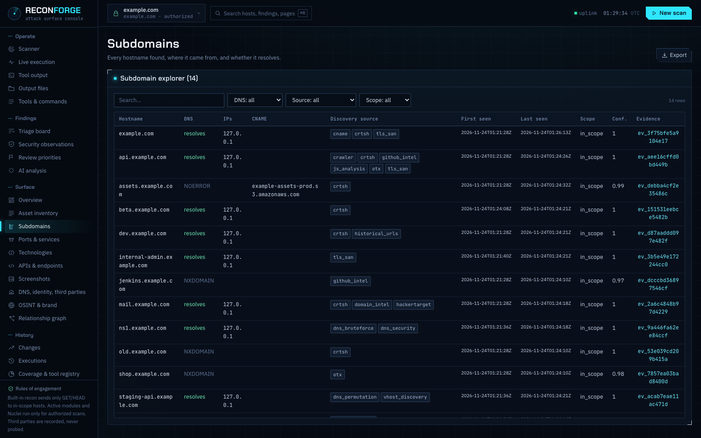 |
| **Screenshots.** Gallery of every web app, look-alike pages collapsed, full-size viewer, download all.<br>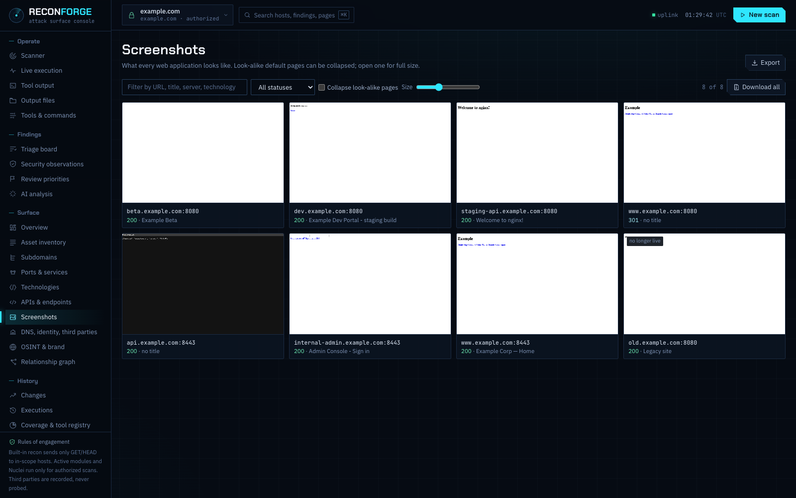 | **Output files.** One folder per execution, one clearly named file per tool and asset type.<br>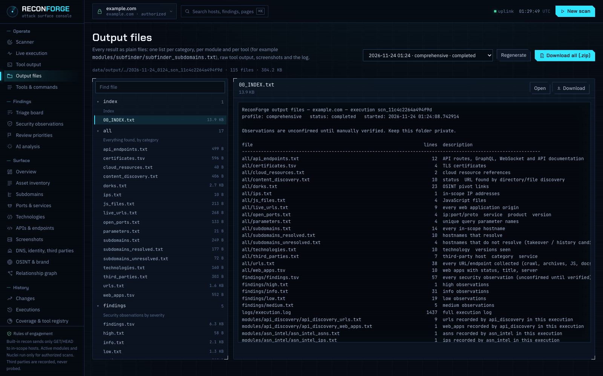 |
| **Tool output.** What each module ran, logged and found, with raw output and downloads.<br>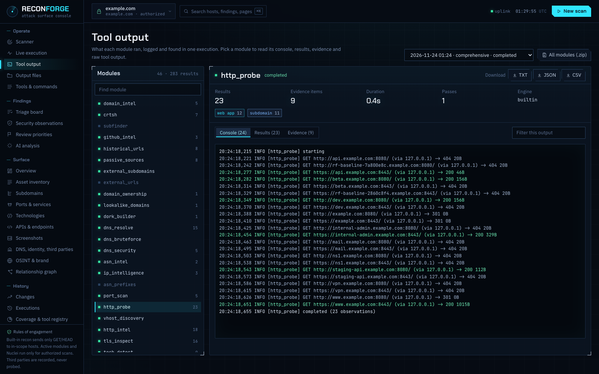 | **Relationship graph.** Domains, hosts, IPs, services, certificates and third parties.<br>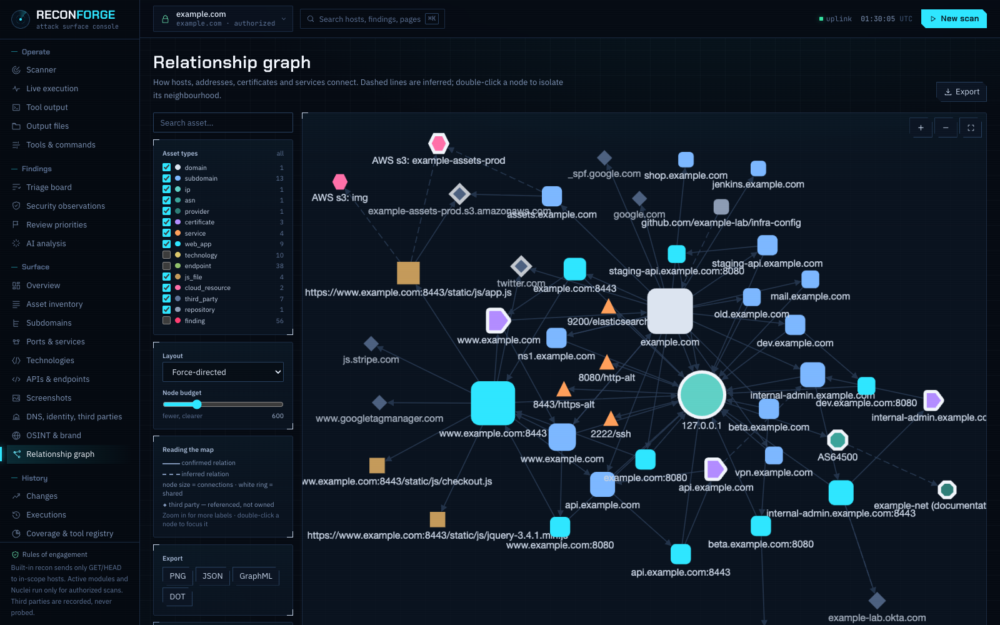 |
| **Changes.** What appeared, disappeared or changed since the previous scan.<br>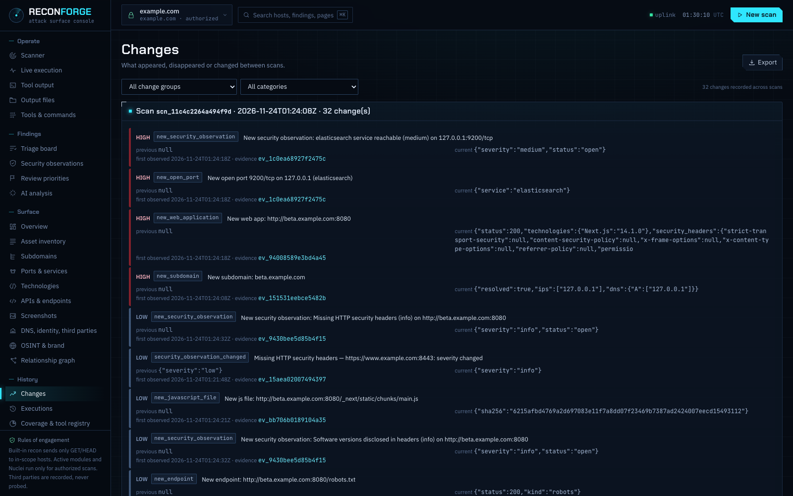 | **OSINT.** Dork links, look-alike domains, gf-style URL lists, contacts and ASN ranges.<br>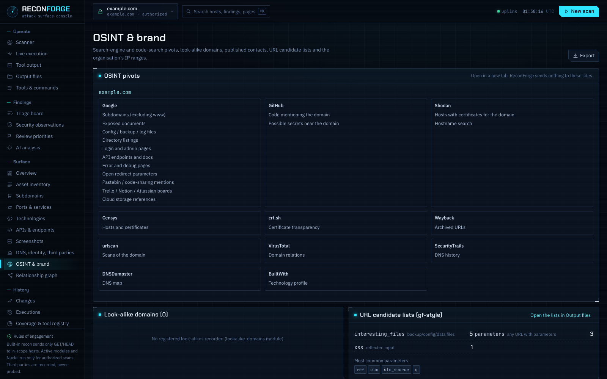 |
| **API keys and notifications.** Keys for 16+ services, plus Slack, Discord, Telegram and e-mail alerts.<br>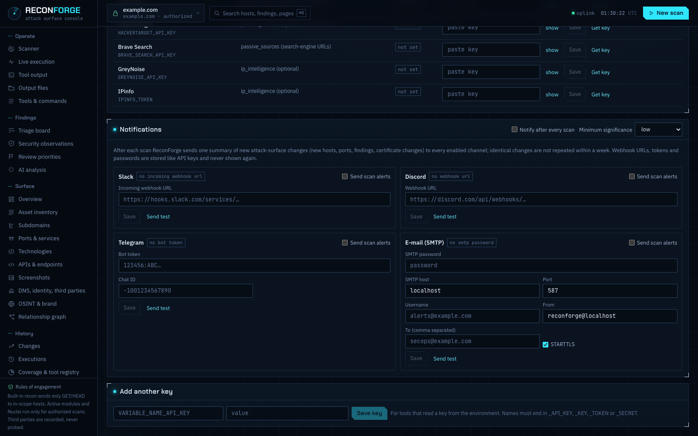 | **Technologies.** Products and versions per host, grouped by role.<br>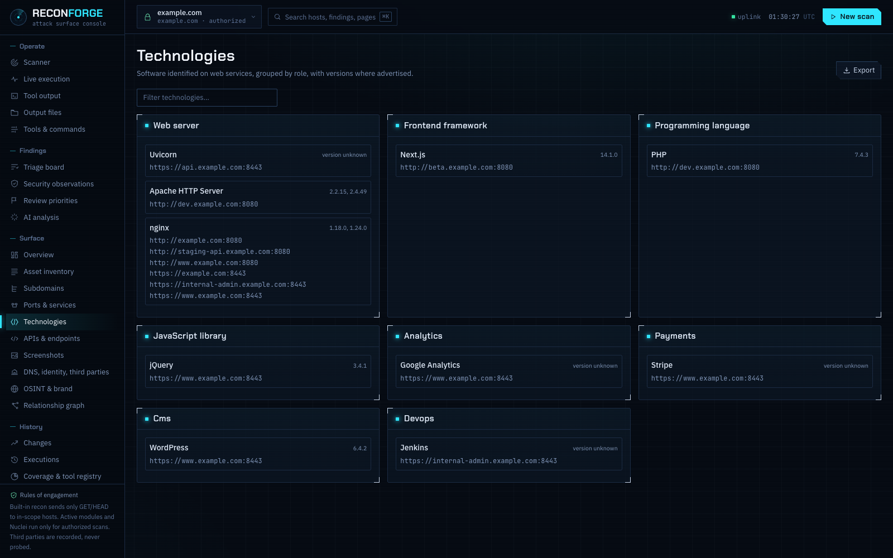 |

## What it does

| Area | Details |
|---|---|
| Subdomain discovery | Certificate Transparency (crt.sh), subfinder, 15+ passive providers (OTX, HackerTarget, urlscan, SecurityTrails, VirusTotal, Shodan, Chaos, WhoisXML, AnubisDB, Cert Spotter, FullHunt, BinaryEdge, LeakIX, Common Crawl, Brave Search), GitHub code search, registry tools (amass, assetfinder, findomain, chaos, github-subdomains), wordlist + permutation + recursive DNS brute force with wildcard filtering, names from TLS certificates, JavaScript, crawling and virtual hosts |
| DNS and e-mail | A/AAAA/CNAME/MX/TXT/NS, wildcard and dangling-CNAME detection, DNSSEC, CAA, SPF depth, DMARC, DKIM selectors, MTA-STS, TLS-RPT, BIMI, optional AXFR check, RDAP registration data |
| Network and IP | ASN, provider and CDN mapping, announced prefixes, Shodan InternetDB, GreyNoise, IPinfo, configured TCP ports and banners (built-in, nmap or naabu) |
| Web | HTTP/HTTPS probing with default-vhost filtering, TLS certificates, technology fingerprinting, favicon hashes, WAF/CDN detection, security headers, cookies, CORS checks, bounded crawling, JavaScript endpoint and secret-pattern analysis, source maps, OpenAPI/GraphQL/OIDC discovery, security.txt, sitemap, mobile app links, exposed files (VCS, env, backups; secrets redacted), admin and DevOps panels, login/SSO detection, WordPress/Drupal/Joomla details, dirb-style content discovery (built-in, ffuf, feroxbuster, gobuster, dirsearch or dirb), virtual-host discovery, screenshots |
| Assessment | Nuclei template library, CVE and end-of-life matching, subdomain-takeover fingerprints, cloud resource references, gf-style URL lists (xss, sqli, ssrf, redirect, lfi, rce, idor), broken-link hijacking candidates, look-alike domains, OSINT dork links |
| Triage | Priority score per finding, decision states (new, investigating, confirmed, false positive, accepted risk, fixed) with notes, bulk updates, most-exposed hosts |
| History | Every observation kept with source, time and evidence; change detection between scans (30+ categories); schedules; notifications |
| Reports and exports | Markdown, HTML, JSON, CSV and PDF reports; CSV/JSON/Markdown export of every page; per-tool output files; Burp Suite scope file; graph export (PNG, JSON, GraphML, DOT) |
| AI analysis (optional) | Claude, OpenAI or any OpenAI-compatible endpoint, or an offline rule-based analyst. An evidence guard rejects statements that cite hosts, ports or CVEs that were not collected |
| Tool registry | 70 tools with install method, purpose, inputs/outputs, API variables and maintenance status; installed from the dashboard or `install.sh` |

## Installation

macOS (Homebrew), Ubuntu/Debian and Kali Linux:

```bash
git clone https://github.com/<you>/ReconForge.git
cd ReconForge
./install.sh
```

The installer:

- creates `.venv`, installs ReconForge and its Python dependencies, builds the dashboard if needed, and
  links `~/.local/bin/reconforge`;
- installs the recon tools it can (subfinder, dnsx, httpx, tlsx, katana, nuclei, naabu, chaos, shuffledns,
  puredns, massdns, amass, assetfinder, findomain, github-subdomains, waybackurls, gau, waymore, ffuf,
  gobuster, feroxbuster, dirsearch, gitleaks, trufflehog, retire, nmap, sslscan, whatweb, Chrome), reusing
  working copies and installing Go 1.22+ first if needed;
- runs `reconforge tools --detect`, which checks each binary is the right program and records its path in
  `~/.reconforge/tool-paths.yaml`;
- creates `config/reconforge.yaml` from `config/reconforge.example.yaml` if it does not exist;
- adds `~/go/bin` and `~/.local/bin` to `PATH` in `~/.zshrc` / `~/.bashrc` (skip with `--no-shell-rc`).

Options: `--app-only`, `--tools-only`, `--skip "amass trufflehog"`, `--yes`. Every built-in module works
without any external tool; installed tools add sources and engines. Missing tools can also be installed
later from the dashboard's **Tools & commands** page. See [docs/INSTALL.md](docs/INSTALL.md).

## Quick start: dashboard

```bash
reconforge
```

This starts the dashboard at http://127.0.0.1:8765 and opens it in your browser
(`reconforge --port 9000 --no-browser` to change that).

1. **Scanner → New scan.** Paste targets: domains, IP addresses, CIDR ranges or URLs, one per line.
   Add optional scope rules, pick a profile and tick **I am authorized to test these targets** (without
   it, only passive modules run). Press **Run**.
2. **Live console** streams every DNS query, HTTP request, connection and external command as it
   happens, with module progress, live counters and a Stop button.
3. When the scan finishes, start at **Triage**: findings are ordered by priority. Record a decision and
   a note for each, or select several and update them together.
4. Explore by surface: **Subdomains**, **Infrastructure**, **Ports**, **Technologies**, **Endpoints**,
   **Security**, **OSINT**, **Graph**. Every page has an **Export** menu (CSV, JSON, Markdown).
5. **Screenshots** shows every captured web app; **Output files** has one text file per tool and asset
   type for each execution; **Tool output** shows each module's console, results and raw output.
6. **Changes** lists what is new, removed or different since the previous scan. **Schedules** repeats
   scans hourly, daily, weekly, monthly or on a cron expression.
7. Press **Ctrl+K** (⌘K on macOS) anywhere to jump to a page or search hosts, URLs and findings.

Without a config file, data is kept in `~/.reconforge` (override with `RECONFORGE_HOME`). With one:
`reconforge -c config/reconforge.yaml`. The dashboard only accepts requests addressed to localhost; to
expose it on a network, set `RECONFORGE_API_TOKEN` (and `api.allowed_hosts`). See
[docs/DASHBOARD.md](docs/DASHBOARD.md).

## Quick start: command line

1. Add a target to `config/reconforge.yaml` (every option is documented in
   [config/reconforge.example.yaml](config/reconforge.example.yaml)):

   ```yaml
   targets:
     - name: example-corp
       root_domains: [example.com]
       ip_targets: [203.0.113.0/28]
       profile: standard
       authorization: {confirmed: true}
       scope:
         include: ["example.com", "*.example.com"]
         exclude: ["legacy.example.com"]
   ```

2. Scan and open the dashboard:

   ```bash
   reconforge -c config/reconforge.yaml scan example-corp --profile standard -v
   ```

   ```bash
   reconforge -c config/reconforge.yaml serve --with-scheduler
   ```

Common commands:

```text
reconforge scan <target> [--profile passive|standard|comprehensive|continuous] [--add m1,m2] [--skip m3]
                         [--incremental|--full] [--ai] [--no-report] [--notify|--no-notify]
reconforge scans / show <scan> / changes <scan> / diff <scanA> <scanB>
reconforge assets <target> [--type web_app] [--search api]      reconforge history <asset_id>
reconforge fp <asset_id> --reason "..." [--unset]
reconforge report <scan> [--formats html,pdf] [--disable cve,evidence]
reconforge analyze <scan> [--provider anthropic|heuristic]
reconforge notify <scan> [--channels slack,email]
reconforge graph <target> --format graphml|dot|json --out file
reconforge schedule add --name n --target t --frequency weekly --day mon --at 03:00
reconforge db backup | export [--target t] | import --path f | retention [--days 90] [--dry-run]
reconforge modules                                               # modules, tool availability, profiles
reconforge tools [--category subdomain_enum] [--detect]          # tool registry and selection status
```

## Profiles and modules

ReconForge has 46 built-in modules. Each belongs to a phase: passive, resolve, network, http,
fingerprint, content, assessment and capture. Modules marked *active* send traffic to the target and
need authorization.

| Profile | Traffic to the target | Adds |
|---|---|---|
| `passive` | None: only DNS resolvers and public data sources | CT logs, subfinder, providers, GitHub, Wayback, DNS, ASN, RDAP, look-alikes, dork links |
| `standard` | Light: one GET per web service, bounded crawl, TLS handshakes | HTTP probing, TLS, technologies, favicons, WAF, crawl, well-known files, screenshots, headers, cloud references, contacts, panels, takeover fingerprints, URL lists, broken links |
| `comprehensive` | Full: configured ports, JavaScript, API docs, exposed files, content discovery, Nuclei | port scan, vhosts, JS analysis, source maps, API discovery, exposed files, CORS, CMS details, content discovery, Nuclei, CVE matching |
| `continuous` | Like standard, incremental, notifications on | Scheduled monitoring |

Override a profile in the config, define your own, or change one run with `--modules`, `--add` or
`--skip`. Single modules and tools can be run from **Tools & commands**. Module details and how to write
a plugin: [docs/MODULES.md](docs/MODULES.md).

## API keys and notifications

**Settings → API keys & notifications** lists every key a module or registered tool can use (Shodan,
SecurityTrails, VirusTotal, Chaos/PDCP, GitHub, Cert Spotter, FullHunt, BinaryEdge, LeakIX, WhoisXML,
OTX, urlscan, HackerTarget, Brave Search, GreyNoise, IPinfo, and any custom `*_API_KEY`). Keys are saved in
`data/settings.json` with file mode 600, passed to scans and external tools (subfinder gets them through
a temporary provider config), and never sent back to the browser.

The same page configures scan alerts for **Slack, Discord, Telegram and e-mail**: one summary of new
changes per scan, with duplicates suppressed for a week. Webhook URLs, tokens and passwords are
write-only, and **Send test** sends a message that contains no scan data.

Environment variables work too: anything set in the shell (for example `export SHODAN_API_KEY=…`) is
used when no dashboard value is saved.

## Output files

After every execution ReconForge writes plain-text files you can feed to other tools:

```text
data/output/<target>/<date>_<scan id>/
├── 00_INDEX.txt                      what every file contains, with line counts
├── all/                              subdomains.txt, live_urls.txt, ips.txt, open_ports.txt, endpoints.txt, …
├── findings/                         findings.tsv and one file per severity (high.txt, medium.txt, …)
├── urls/gf/                          xss.txt, sqli.txt, ssrf.txt, redirect.txt, lfi.txt, idor.txt, …
├── modules/<module>/                 e.g. modules/subfinder/subfinder_subdomains.txt,
│                                          modules/crtsh/crtsh_subdomains.txt, modules/port_scan/port_scan_open_ports.txt
├── raw/<module>/                     unmodified tool output (JSON, XML, text)
├── screenshots/                      one PNG per web app
└── logs/execution.log
```

Browse, preview and download them (individually or as a zip) on the **Output files** page.

## Publishing this repository safely

Everything a scan produces is written under `data/` (or `~/.reconforge`): the database, evidence,
reports, logs, output files, screenshots, external tools' scratch files and `settings.json` with your API
keys. External tools run inside `data/work/<scan>/`, which is deleted after the scan, so their reports,
state files and browser profiles never land in the repository.

`.gitignore` excludes:

- `data/` and `lab/runtime/`;
- your local `config/reconforge.yaml` (commit `config/reconforge.example.yaml` instead) and `config/*.local.yaml`;
- `.env` files, keys and certificates;
- dashboard downloads saved into the project (`reconforge-*.csv`, `.json`, `.pdf`, `.zip`, …).

A test (`tests/test_hardening.py::test_gitignore_keeps_scan_data_out_and_source_in`) fails if any of
these would be committed, or if a source folder is accidentally ignored. Before pushing, check:

```bash
git status --ignored
```

```bash
git add -n .
```

Two more things to know before you push:

- Each commit records the name and e-mail from your git config. To keep your address private, set
  `git config user.email "<id>+<username>@users.noreply.github.com"`.
- The dashboard shortens paths in API responses, logs and file previews (`./data/...` inside the
  project, `~/...` elsewhere in your home folder), so screenshots don't reveal your account or folder names.

## Lab and demo data

`lab/lab_server.py` runs a fictional organization entirely on 127.0.0.1: an authoritative DNS server,
HTTP and HTTPS virtual hosts with per-SNI certificates, an SSH banner, a search service, emulators for
crt.sh, Wayback, GitHub, OTX, HackerTarget, Common Crawl, InternetDB and RDAP, and sinks that capture
e-mail, Slack, Discord and Telegram notifications. Phase 2 introduces changes (a new and a removed
subdomain, new API versions, a server upgrade, a CSP header, a reissued certificate, a new open port, a
new third party) so change detection can be seen working.

```bash
./lab/run_demo.sh
```

This runs the full lab walkthrough on the `acme.test` domain (scans, changes, notifications, reports).

```bash
./lab/make_demo.sh
```

This builds the data used for the screenshots above. The lab serves the same organization as
`example.com`; its own DNS server answers those names, so nothing reaches the real example.com. Then
open the demo with:

```bash
.venv/bin/python -m reconforge.cli -c config/demo.yaml serve --port 8790
```

See [docs/LAB.md](docs/LAB.md) for what each step shows.

## Tests

```bash
.venv/bin/python -m pytest -q
```

The suite covers:

- normalization, scope rules, correlation, deduplication and confidence;
- every external-tool parser, fingerprints, JavaScript and cloud analysis, CVE matching;
- the new modules' parsers and soft-404 calibration;
- API keys and notification settings never reaching the browser;
- output-file naming and path-traversal protection;
- DNS-rebinding, cross-site request and token checks;
- the triage workflow;
- `.gitignore` coverage;
- the AI evidence guard;
- the scheduler;
- a full lab integration run, including change detection, notifications, GET-only behavior and every
  report format.

## What has and has not been verified

**Verified end to end against the lab:**

- every built-in module;
- correlation, rediscovery, change detection and incremental scans;
- all four notification channels, against local sinks;
- every report format;
- the offline AI analyst and evidence guard;
- the scheduler, storage operations and the API;
- the dashboard in a browser.

**Not verified against the live services:**

- Passive data providers (they were exercised against the lab emulators or mocked transports).
- The Claude and OpenAI providers (tests mock them).
- Real Slack, Discord, Telegram and SMTP endpoints.
- PostgreSQL. Only SQLite was exercised.
- External tools: their parsers are tested against representative output, but command-line flags can
  change between tool versions.

The CVE data in `reconforge/data/cve_intel.yaml` is a small curated sample. Extend it, or point
`cve_intel.local_db` at your own file.

## Documentation

- [docs/DASHBOARD.md](docs/DASHBOARD.md): dashboard pages, live console, per-tool runs, API keys, notifications, AI providers
- [docs/MODULES.md](docs/MODULES.md): built-in modules, safety properties, writing plugins
- [docs/ARCHITECTURE.md](docs/ARCHITECTURE.md): components, data flow, correlation, change detection, prioritization
- [docs/EXPANSION.md](docs/EXPANSION.md): expansion modules and the tool registry
- [docs/OPERATIONS.md](docs/OPERATIONS.md): scheduling, notifications, backups, retention, deployment
- [docs/DATABASE.md](docs/DATABASE.md) and [docs/schema.sql](docs/schema.sql): data model
- [docs/API.md](docs/API.md): REST API
- [docs/INSTALL.md](docs/INSTALL.md): installer details
- [docs/LAB.md](docs/LAB.md): the controlled lab
